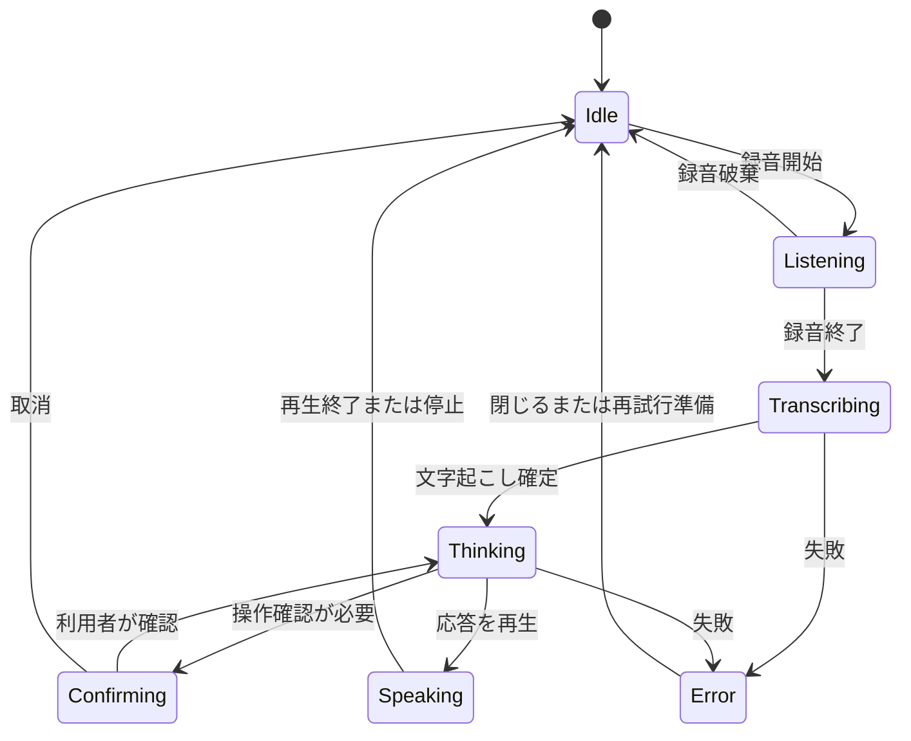

# 要件定義書

| 項目 | 内容 |
| --- | --- |
| プロダクト | Brainoid Agent |
| 文書バージョン | 0.2.0 |
| 更新日 | 2026-10-25（日本時間） |
| 状態 | 開発着手用の設計ベースライン案。実装・実機検証は未実施 |
| 責任ロール | プロダクト責任者。技術責任者・UX担当・QA担当がレビュー |
| 関連文書 | [基本設計](02-architecture.md)、[データ・権限](03-data-and-authorization.md)、[インターフェース](04-interfaces.md)、[開発・検証](05-development-and-testing.md)、[運用](06-deployment-and-operations.md) |

## 1. 目的と成功条件

スマートフォンと家庭・職場のスマートディスプレイから、同じ人格・利用可能な記憶・タスクを持つAIエージェントを利用できるようにする。会話に加えて、ノート、予定、リマインダー、対応する家電の操作を扱う。GCP上で複数の家庭・組織が利用できるサービスと、第三者が自ら構築できるOSSを提供する。

「同じエージェント」とは、テナント単位のエージェント定義と正規のデータを共有することを意味する。会話・記憶の個人／共有区分、発話先、実行権限は独立して判定する。スマホの個人的な会話を、そのまま共有ディスプレイで再生する仕様にはしない。

MVPの到達点は、スマホで保存した明示的な記憶を、許可された範囲でPiから参照し、対象を確認して照明を操作し、その記憶をスマホで訂正できることである。全機能の受入条件は第8節で定義する。

## 2. 合意事項と設計補完

### 2.1 合意済みの前提

- 正式なプロジェクト名はBrainoid Agentとする。

- スマホアプリとスマートディスプレイを提供する。ディスプレイの基準ハードウェアはRaspberry Pi 5、メモリ8 GB。
- クラウドはGCPを使い、テナント分離を実装する。
- コードをOSSとして公開する方針とする。
- MVPのAI機能はオンライン前提とし、将来のローカルLLMへの切替境界を設ける。
- 記憶はエンティティと関係を表せるグラフ構造で扱う。

### 2.2 この版で具体化する初期設計案

React／Capacitor、Python／FastAPI、Firestore上の軽量グラフ、Google Cloudの生成AI・音声機能、Home Assistant連携を採用案とする。スマホの通知はFCMとiOSのAPNs、カレンダーはGoogle Calendarを最初の接続先にする。これらの採用理由と差替境界は[基本設計](02-architecture.md)に記載する。

以下の数値目標、保管期間、操作上限、画面構成は開発を進めるための提案値であり、実測結果や既に締結したSLAではない。変更時は関連仕様と受入テストを同時に更新する。

## 3. 利用者と利用環境

| 利用者・主体 | 利用目的・権限の基本 |
| --- | --- |
| 個人利用者 | 自分の会話・記憶・予定をスマホで管理する。単独利用でも1テナントを持つ |
| 家庭・チームのメンバー | 共有された記憶、タスク、家電を利用する。複数テナントへの参加を許す |
| テナントowner | 会員・端末・共有設定・利用量を管理する。役割だけで他人の個人情報は読めない |
| テナントadmin | 委任された会員・端末・共有情報を管理する。owner変更とテナント削除はownerに限定する |
| 共有端末の話者 | 本人未確認の状態では共有ディスプレイに許可された情報・操作だけを使う |
| OSS導入者 | 対応環境を自ら構築・更新する。公式ホスト版と費用・運用責任が異なる |
| サービス運用者 | 稼働・復旧・不正利用対策を行う。通常の監視に私的な本文の閲覧を必要としない |

スマホはAndroidとiOSを対象とし、最小OS・対応機種は実機検証で固定する。Piはディスプレイ、マイク、スピーカー、電源、冷却、ネットワークを含めた対応構成表を作る。初期は対応機材を自ら準備できる導入者を想定し、不特定のUSB音響機器すべての動作を保証しない。

## 4. 機能範囲

### 4.1 MVPの機能要件

すべてのFRはMVP公開条件に含む。開発順序の優先度は実装の依存関係を表し、機能カテゴリを将来版へ移す意味ではない。

| ID | 機能 | 要件と境界 |
| --- | --- | --- |
| FR-001 | 認証・テナント | サインイン／サインアウト、テナント作成・選択、所属一覧を提供する。選択したテナントはサーバーが所属と照合する |
| FR-002 | 会員と権限 | owner／admin／memberを管理する。招待は期限・一回性を持ち、本人が参加を受諾する。最終ownerの離脱には移譲またはテナント削除を必要とする |
| FR-003 | 端末登録・失効 | スマホで一回性のコード／QRを確認し、Piをテナントに登録する。端末ごとの機能・許可対象・失効を管理する。初期化時に資格情報と個人キャッシュを消去する |
| FR-004 | 会話と共有人格 | テキスト会話、履歴、ストリーミング表示、処理取消、エラー表示を提供する。人格・話し方の設定はエージェント単位。会話は個人／共有を明示する |
| FR-005 | 音声・キャラクター | タップで録音を開始・終了し、文字起こし・応答生成・読み上げを行う。2D表示で待機・聴取・思考・発話・エラーを示す。音声停止とマイク状態を常に操作・確認できる |
| FR-006 | グラフ記憶 | 明示的な保存、検索、出典の表示、訂正、忘却を提供する。人・部屋・機器・好み等の関係を扱う。AI推測は候補状態とし、利用者の確定前に既知の事実として使わない |
| FR-007 | ノート | ノートの作成・一覧・検索・編集・削除を提供する。会話からの保存では保存内容と個人／共有を確認可能にする |
| FR-008 | タスク | タスクの作成・期限・一覧・編集・完了・取消を扱う。完了は利用者の操作または許可された確定イベントを根拠にし、AIの文章だけでは完了しない |
| FR-009 | リマインダー・通知 | 一回性の日時指定、編集、取消、既読・スヌーズを提供する。スマホ通知と許可されたPiに配信する。タイムゾーンを保存し、OS通知が未許可でもアプリ内で確認できる |
| FR-010 | Google Calendar | 利用者単位で連携・解除する。選択したカレンダーの予定参照と、確認画面を経た予定作成・変更・削除を提供する。日時・終日・タイムゾーン・対象予定を明示する |
| FR-011 | 家電操作 | Home Assistantで登録された照明・空調の許可済み操作を提供する。対象名が曖昧なら特定するまで実行しない。状態設定と実行結果を記録する |
| FR-012 | 個人セッション・引継ぎ | スマホからPiでの短命な個人セッションを開始・終了できる。共有／個人の状態と発話先を常時表示する。終了時に私的な表示・音声キュー・一時データを消去する |
| FR-013 | 削除とエクスポート | 会話削除、記憶の忘却、テナント離脱、アカウント／テナント削除を区別する。利用者がアクセスできる自己データを機械可読形式でエクスポートできる |
| FR-014 | 回復・更新 | ネット断・クラウド再接続・Pi再起動から回復する。期限切れ操作を後から実行しない。端末のバージョン確認・更新・失敗時復旧を提供する |
| FR-015 | 運用・利用量 | テナント別の利用量・制限、エラー追跡、監査、異常通知を提供する。利用者に上限到達と再試行可否を示す |

### 4.2 将来対応

常時ウェイクワード、声紋による本人認証、ローカルLLM／ローカル音声、推測した記憶の自動確定、繰り返し予定・複雑な繰り返しリマインダー、他社カレンダー、複数エージェントの協調、専用グラフDB、複数リージョンでの同時稼働は将来対応とする。

MVPで公開しないツールは、任意コード実行、ドアの解錠、購入・決済、利用者の確認を伴わない外部へのメッセージ送信である。機能追加時は対象・確認・取消・再送の契約と受入条件を追加する。

## 5. 代表的な利用シナリオ

### UC-01 初回利用と端末登録

スマホでサインインし、テナントを作成する。Piが表示するコードを読み取り、端末名・設置場所・共有表示範囲・操作可能な家電を確認する。登録後、Piは独自の端末資格情報で接続する。別テナントに移す場合は、既存登録を解除して初期化し、再登録する。

### UC-02 記憶を共有して家電を操作する

スマホで「就寝前はリビングの照明を20%にして」と明示的に保存する。共有可否と対象の照明を確定し、記憶の出典を残す。Piで「寝る準備をして」と依頼すると、許可された記憶を検索し、対象・操作が確定した範囲でコマンドを送る。Home Assistantが報告した目標状態を確認して結果を表示する。「実機の照度が20%になった」といった未観測の事実までは断言しない。

### UC-03 個人の予定をPiで確認する

通常の共有モードで「私の明日の予定」を尋ねても、本人未確認の予定を取得しない。認証済みスマホで対象Piに個人セッションを開始し、会話・表示・音声をそのユーザーの権限に限定する。初期案では最大5分、無操作60秒で終了する。延長はスマホから明示的に行い、退出・端末ロックでも終了できる。

### UC-04 カレンダーへ予定を登録する

「明日15時に打合せを追加して」を受け、日付・タイムゾーン・終了時刻・カレンダーを含む候補を表示する。不明点を解消後、利用者が具体的な内容を確認する。実行時には確認対象と現在の引数が一致することを検証する。外部APIの結果が不明な場合は照合し、同じ予定を無条件に再作成しない。

### UC-05 記憶を忘れてもらう

記憶一覧から対象と出典を確認し「忘れる」を実行する。削除受付が確定した時点で検索対象から除外し、関連する要約・検索用ベクトル・キャッシュを削除する。過去の会話を残す場合、その文章から同じ記憶を自動再抽出しないための抑止を記録する。会話本文も削除するかを別操作として案内する。

### UC-06 通信断から回復する

Piがオフラインになったら接続状態を示し、AI会話とクラウド経由の新規操作を受け付けない。設定・マイク停止・再接続案内はローカルで操作できる。復旧時に正規状態を同期し、期限切れの操作は破棄する。結果不明の操作を照合し、古いリマインダーは配信方針に従って未読一覧にまとめる。

## 6. 画面と音声の仕様

### 6.1 主要画面

| 画面 | スマホ | Pi |
| --- | --- | --- |
| ホーム・会話 | テナント選択、個人／共有会話、文字入力、音声開始、結果カード | 大きな状態表示、音声開始・停止、共有情報、接続状態 |
| 記憶 | 一覧、出典、確定状態、共有範囲、訂正、忘却 | 許可された記憶の参照。個人情報の編集はスマホへ案内 |
| ノート・タスク・予定 | 一覧・編集・確認・取消 | 直近の許可済み情報、簡単な確認・完了操作 |
| 端末・連携 | 登録、許可設定、失効、Google Calendar連携、通知設定 | 端末状態、音量、マイク、ネットワーク回復、初期化案内 |
| アカウント・データ | 所属、エクスポート、削除、利用量 | 個人セッションの終了、共有状態への復帰 |

確認カードには操作対象・変更内容・実行先・個人／共有・確定操作を表示する。エラーには原因の分類と、再試行・入力変更・設定変更のいずれが必要かを表示する。視覚的な色だけに依存せず、状態名と操作ラベルを併記する。

### 6.2 会話状態

`offline`、`muted`、`private_session`は上記と独立した状態として持つ。会話がIdleでもマイクがミュートか、端末が個人セッション中かを表示する。

### 6.3 停止・取消の意味

| 操作 | 必須の挙動 |
| --- | --- |
| 録音停止 | 入力の取り込みを停止する。送信するか破棄するかはボタンを区別する |
| 読み上げ停止 | 端末の再生と未再生キューを停止する。実行済み家電操作の取消とは連動しない |
| 応答生成停止 | runの取消を要求し、以後の不要な生成・読み上げを抑止する |
| 未実行操作の取消 | 実行前のコマンド／確認候補を取消状態にする。取消と実行が競合した場合は実際の結果を示す |
| 実行済み操作の戻し | 元の操作の取消扱いにはせず、新しい許可・確認を伴う別の操作として扱う |

マイク権限や通知権限が拒否された場合も、文字入力・アプリ内一覧・設定案内から利用を続けられる。スマホのバックグラウンド常時録音はMVPに含めない。

## 7. 非機能要件

### 7.1 設計目標

測定環境は基準Pi、対応スマホ、対象リージョン、実際のモデル／音声構成、安定したネットワークで固定する。初期負荷仮説は100テナント、接続中Pi50台、同時会話20件。計測ではp50・p95・失敗率を記録し、コールドスタート、プロバイダー待ち、ネットワーク遅延を内訳として残す。

| ID | 分類 | 初期目標・受入れ方針 |
| --- | --- | --- |
| NFR-001 | テナント・権限分離 | API、グラフ探索、ベクトル検索、ジョブ、音声、通知で権限を検証する。別テナントや他人のprivate情報へのアクセス成功を0件とする |
| NFR-002 | 応答時間 | 文字送信から最初の応答差分までp95 5秒以内、発話終了から最初の音声までp95 8秒以内を設計目標とする。外部API障害時は別集計し、全体の失敗率も残す |
| NFR-003 | 操作・通知遅延 | オンライン時の家電操作受付から規定の結果までp95 5秒以内。due_atからリマインダー配信処理開始までp95 60秒以内を目標とする。OSによる最終通知表示時刻は保証しない |
| NFR-004 | 再送・整合性 | コマンド重複で副作用を重ねない。結果不明と成功を区別する。同時編集はversion競合として通知し、無言で上書きしない |
| NFR-005 | 削除・保持 | 削除受付の確定後は検索不可とし、正規・派生データの消去は24時間以内を目標とする。自前の生音声の永続保存は既定で無効。バックアップ保持の初期案は7日、独立した削除台帳は30日。復元時は最新の削除台帳を再適用してからサービスを開放する |
| NFR-006 | 失効・セッション | オンライン端末の失効反映は60秒以内を目標とする。資格情報の有効期限だけに依存せず、操作時と接続中の状態を確認する |
| NFR-007 | 復旧・可観測性 | request_id／run_id／command_idで処理を追跡する。バックアップからの復元訓練を公開前に実施する。RPO 24時間・RTO 4時間を初期の運用設計目標とする |
| NFR-008 | 移植性・互換性 | AgentCoreをHTTP・GCP・端末実装から分離する。端末プロトコルとデータschemaをバージョン管理し、更新時の互換範囲を定義する |
| NFR-009 | 費用・利用制限 | テナント別にモデル・音声・検索・接続の利用量を計測し、利用枠と同時実行数を制限する。月額の販売価格・許容原価はOPEN-005で確定する |

NFR-002、003、007の数値は未計測である。最初の垂直実装で基準値を測り、公開β前に採否を決める。目標を変更する場合は理由・測定条件・利用者への影響を決定記録に残す。可用性の対外SLAはこの版では設定しない。

### 7.2 情報の取り扱い

記憶の出典とAI推測を区別する。モデルへ送る情報を、依頼に必要な許可済み範囲へ絞る。通常ログには会話本文・生音声・認証情報・カレンダー本文を記録しない。障害調査用の追加収集は対象、期間、許可、削除方法を定める。外部プロバイダーの保持と自サービスの保持を別に確認・説明する。

家電の状態は接続先が報告した状態、会員権限はmembership、タスクの完了はタスク記録を正とする。LLMの推測やグラフ上の関係を権限・実行成功の根拠にしない。

## 8. 受入基準と追跡

| 受入ID | 対応要件 | 合格条件 |
| --- | --- | --- |
| AC-001 | FR-001、NFR-001 | 2テナントを用意し、URL・ID・リクエスト本文を差し替えても別テナントの情報を取得・変更できない |
| AC-002 | FR-002 | memberの管理操作を拒否する。adminでも他人のprivate会話は読めない。最終ownerを失う操作を拒否する |
| AC-003 | FR-003、NFR-006 | 登録コードの再使用・期限切れを拒否する。端末失効後は新規接続と操作を拒否し、接続中も目標時間内に停止する |
| AC-004 | FR-004 | 同じagent設定を両画面で利用できる。会話の個人／共有を保持し、再接続後の重複メッセージを抑止する |
| AC-005 | FR-005、NFR-002 | 日本語で録音→文字起こし→応答→読み上げが完了する。停止で未再生音声を消去し、マイク拒否時も文字入力できる |
| AC-006 | FR-006 | 保存後に出典付きで取得できる。訂正後に古い事実を現行の事実として使わない。忘却後に古いジョブや検索索引から復活しない |
| AC-007 | FR-007 | ノートの作成・検索・編集・削除とprivate／sharedの権限を確認する。同時更新で競合を検知する |
| AC-008 | FR-008 | タスクの期限・完了・取消が両端末へ反映される。AIの成功文だけでは完了状態が変わらない |
| AC-009 | FR-009、NFR-003 | 時差を含む指定日時で配信処理が始まる。通知の重複、取消後配信、private本文のロック画面露出を防ぐ |
| AC-010 | FR-010 | 予定参照が委任範囲に収まる。未確認・改変・期限切れの書込候補を拒否する。API結果不明時に予定を二重作成しない |
| AC-011 | FR-011、NFR-004 | 正しい家庭・機器へ許可済みの状態設定を行う。重複・期限切れコマンドを再実行せず、HA失敗や未確認の結果を成功と表示しない |
| AC-012 | FR-012 | 共有モードでprivate情報を取得しない。個人セッション終了後に画面・音声・キャッシュからprivate情報を参照できない |
| AC-013 | FR-013、NFR-005 | 自己データを取得できる。削除範囲の違いを確認でき、派生データ・ジョブ・バックアップ復元時の再出現を抑止する |
| AC-014 | FR-014、NFR-007、008 | ネット断、Pi再起動、Cloud Run再接続、旧端末版との組合せで回復する。更新失敗時に直前の動作版へ戻せる |
| AC-015 | FR-015、NFR-009 | 利用枠の超過を抑止し、対象テナントに説明する。本文を露出せず障害・遅延・費用を追跡できる |

全ACの成功例に加え、入力誤り・権限不足・依存先障害の例を[開発・検証ガイド](05-development-and-testing.md)のテスト計画で実装する。性能目標の計測は機能ACの合否と別の結果表で記録する。

## 9. 開発順序と完了の定義

| 段階 | 完了させる内容 | 主な成果 |
| --- | --- | --- |
| M0 | 環境・契約・基盤 | リポジトリ、依存固定、認証、2テナント、モック、API契約 |
| M1 | テキストの垂直実装 | スマホ・Piから共通エージェントへ接続、会話・権限・端末登録 |
| M2 | 記憶と操作 | グラフ記憶、訂正・削除、Home Assistant、重複・結果不明の処理 |
| M3 | 日常機能 | ノート、タスク、リマインダー、Google Calendar、通知 |
| M4 | 音声と端末UX | 日本語音声、キャラクター、個人セッション、切断・停止の実機検証 |
| M5 | 公開準備 | 全AC、性能・費用の校正、復旧訓練、対応機材、OSS・配布手続 |

各機能の完了には、実装、権限を含む検証、エラー時のUI、必要な監視、関連仕様の更新を含む。公開時には重大なAC不合格を残さず、未達の定量目標は変更判断を記録する。

## 10. 未決事項と決定期限

| ID | 決めること | 責任ロール | 決定期限・理由 |
| --- | --- | --- | --- |
| OPEN-001 | リポジトリ、パッケージ識別子、ドメイン。正式名称Brainoid Agentは確定 | プロダクト責任者 | 外部連携の登録前。配布先・識別子をOAuthとアプリ設定に揃える |
| OPEN-002 | メンテナ、障害連絡先、脆弱性の私的報告先 | プロダクト／運用責任者 | 外部テスター受入れ前。実在しない連絡先を公開しない |
| OPEN-003 | 対応スマホOS・Pi周辺機器・音響条件 | クライアント／端末担当 | M1で候補固定、M4で実測。UI・音声品質の基準にする |
| OPEN-004 | OSSライセンス最終採用と第三者素材 | メンテナ | 公開前。同梱LICENSEはApache-2.0の採用案とし、音声・モデル・素材は別に確認する |
| OPEN-005 | リージョン、モデル、音声、保持条件、費用枠 | 技術／運用責任者 | Firestore作成・実課金接続前。候補はasia-northeast1、サービス間の利用可否を検証する |
| OPEN-006 | OAuth、APNs、ストア登録、公開時の説明・削除導線 | モバイル／連携担当 | M3開始前に手続を開始、公開前に完了する |
| OPEN-007 | 遅延・負荷・復旧の数値目標の校正 | QA／技術責任者 | M2で中間計測、M5で採用値を確定する |

これらは内容未記入の欄ではなく、開発中に実測・権利者・運用主体の情報で確定する判断である。各担当の個人名と期日は、チーム立上げ時にIssueへ割り当てる。

## 11. 参照資料

本書の機能範囲・数値・受入条件は本プロジェクトの設計提案。接続先に関する仕様は以下を参照する（2026-10-25確認）。

- [Google Calendar APIのOAuthスコープ](https://developers.google.com/workspace/calendar/api/auth)：機能ごとに必要最小限の委任範囲を選ぶ。
- [Firebase Cloud MessagingのAppleアプリ設定](https://firebase.google.com/docs/cloud-messaging/ios/get-started)：iOS通知のAPNs設定・利用者への許可要求。
- [Raspberry Pi公式キオスク構築](https://www.raspberrypi.com/tutorials/how-to-use-a-raspberry-pi-in-kiosk-mode/)：表示端末の実装方針の基礎。
- 仕様の判断根拠と製品制約の詳細は[基本設計](02-architecture.md)および[参考資料](07-references.md)を参照する。
