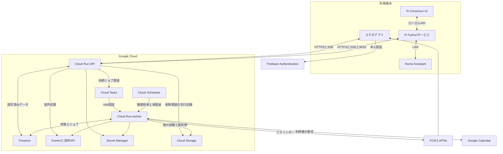
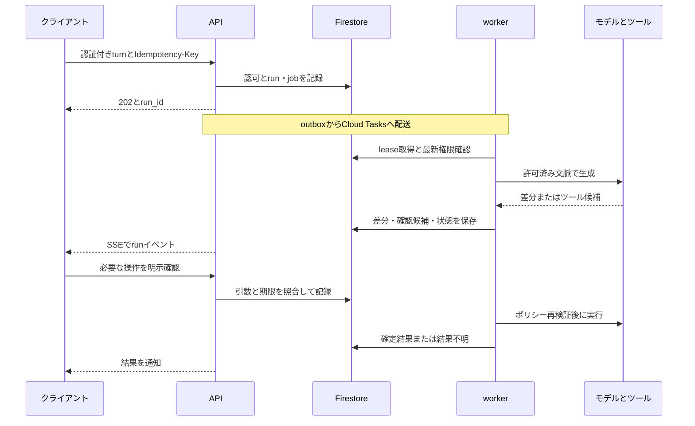
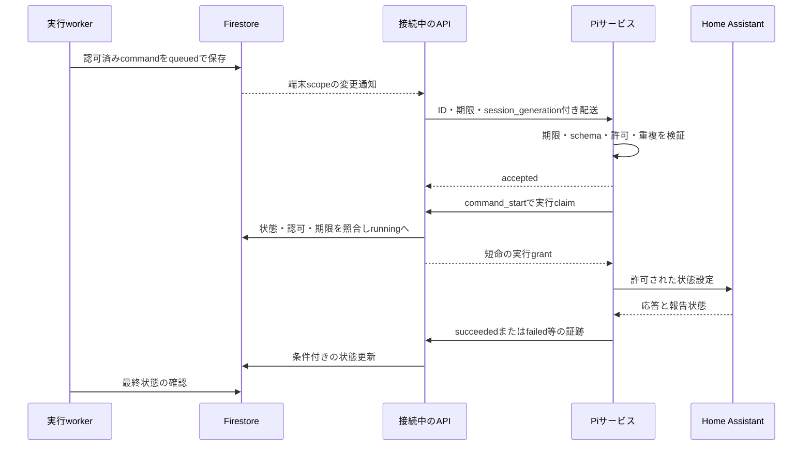

# 基本設計書と技術スタック

| 項目 | 内容 |
| --- | --- |
| プロダクト | Brainoid Agent |
| 文書バージョン | 0.2.0 |
| 更新日 | 2026-10-25（日本時間） |
| 状態 | 開発着手用の設計ベースライン案。構築・実装は未実施 |
| 責任ロール | 技術責任者。バックエンド・クライアント・端末・運用担当がレビュー |
| 関連文書 | [要件](01-requirements.md)、[データ・権限](03-data-and-authorization.md)、[インターフェース](04-interfaces.md)、[開発・検証](05-development-and-testing.md)、[運用](06-deployment-and-operations.md) |

## 1. 設計方針

MVPはクラウドを正規状態の保存先とする。スマホとPiは共通のAgentCoreを呼び出し、テナント単位のエージェント定義と認可済みの記憶を利用する。Piは画面・音声入出力・ローカル機器接続を担当し、生成AIの推論はGCP側へ委譲する。

バックエンドは1つのコードベースからAPIとworkerを配備する。機能ごとの境界をPythonパッケージとして持ち、最初から多数の独立サービスに分割しない。APIは対話と認可、workerは永続ジョブの実行を担当する。長時間の処理を、HTTP応答後のプロセス内タスクだけに任せない。

GraphMemoryStore、ModelProvider、ToolExecutor等の境界を設け、将来はPi上でもAgentCoreを実行できるようにする。ただしMVPでは、オフライン推論・同期競合解決・ローカル音声モデルの実装まで行わない。

## 2. 全体構成

図のAPI→Cloud Tasksは配送経路を表す。業務データとジョブをFirestoreへ先に記録し、直後の配送が失敗してもSchedulerが呼ぶdispatcherで回収する。会話runの実行と外部ツール呼出しの具体的な経路は第5節に定義する。

### 2.1 正規状態の所在

| 情報 | 正規の保存先・判定元 |
| --- | --- |
| テナント、会員、端末許可、会話、記憶、タスク | Firestore。認可判定はバックエンドのPolicyEvaluator |
| 人の認証 | Firebase Authentication。テナント所属はFirestore membershipで追加検証 |
| 家電の報告状態 | Home Assistant。グラフ記憶の過去状態は操作結果の判定に使わない |
| Google Calendarの予定 | Google Calendar。ローカル索引は取得時刻と出典IDを持つ派生データ |
| 機器の資格情報・処理済みcommand_id | Piの保護されたローカル保存領域。設定・重複排除はSQLite |
| 外部連携の秘密情報 | クラウドはSecret Manager、PiのHome Assistant資格情報はOS保護されたローカル領域 |
| 削除・認可変更台帳、端末リリース配布物 | Firestoreの復元から独立したCloud Storage。用途別bucket・IAMで分離する |
| UI状態、音声バッファ、生成途中の差分 | 一時状態。重要なrun状態・結果はクラウドへ永続化する |

## 3. 技術スタックと採用理由

| 領域 | 採用案 | 判断理由・境界 |
| --- | --- | --- |
| 共通UI | React、TypeScript、Vite | 会話・カード・設定部品を共有し、フォームファクター別の画面を作る |
| スマホ | Capacitor | Web UIをAndroid／iOSに組み込み、録音・通知・安全な資格情報保存はネイティブadapterを利用する |
| Pi画面 | Raspberry Pi OS 64-bit、Chromium kiosk | 専用の全画面表示と、共通UIの再利用を両立する |
| Piサービス | Python、systemd、SQLite | 音声・クラウド接続・家電操作をUI再読み込みから分離する |
| API | Python、FastAPI、Pydantic | 入出力検証とOpenAPIを中心にクライアントとの契約を管理する |
| AgentCore | 小さな共有Pythonパッケージ | モデル選択、文脈構築、ツール制御をクラウド固有実装から分離する |
| LLM | Google Gen AI SDK、Google CloudのGemini | GCPの認証・運用へ統合する。モデルID・利用リージョンは設定で固定する |
| 音声 | Cloud Speech-to-Text、Cloud Text-to-Speech | MVPは文字を境界として会話処理を共通化する。リアルタイム音声は別adapterで比較可能にする |
| データ・記憶 | Firestore Standard、vector search | 業務状態と軽量なグラフを同じ基盤で扱う。可変長の大規模グラフ処理は初期要件に含めない |
| 人の認証 | Firebase Authentication | 認証とアプリのテナント所属を分け、複数テナント参加を表現する |
| 非同期 | Cloud Tasks、Cloud Scheduler、Cloud Run worker | リトライ、期限到来の探索、永続ジョブからの復旧を行う |
| 通知 | FCM、iOSはAPNs連携 | スマホが前面にない場合のリマインダー経路を設ける |
| 家電 | Home Assistant API | Piから許可したLAN内接続先へ操作する |
| カレンダー | Google Calendar API | ユーザー単位のOAuth連携として実装し、権限・確認を独立して扱う |
| 構築・配布 | Docker、Terraform、GitHub Actions | 配備設定と変更履歴をレビュー可能にし、同じイメージを段階的に昇格する |
| 秘密情報・監視 | Secret Manager、Cloud Logging、Cloud Monitoring | 端末・会話の本文と運用ログを分離する |
| 削除台帳・配布物 | Cloud Storage | 削除要求をDB復元で失わないようにし、署名付きの端末更新assetを保管する |

CapacitorはWeb UIとネイティブ機能を組み合わせる構成を提供し、Piのキオスク構築は公式の構築手順を参照できる。[Capacitor](https://capacitorjs.com/docs)、[Raspberry Pi kiosk](https://www.raspberrypi.com/tutorials/how-to-use-a-raspberry-pi-in-kiosk-mode/)。Google Cloud向けモデルadapterは[Google Gen AI SDK](https://docs.cloud.google.com/vertex-ai/generative-ai/docs/sdks/overview)を基準にする。ランタイム・依存ライブラリは実装開始時に対応範囲を確認し、lockfileと対応表へ固定する。

## 4. コンポーネントの責任

### 4.1 フロントエンドとPi

共通UIは会話カード、記憶カード、操作確認、ローディング・エラー状態、API型を共有する。スマホは編集と個人情報の操作、Piは離れた位置からの状態確認・音声・共有情報に重点を置く。録音、通知、資格情報保管はClientPlatformAdapterにまとめる。

PiのPythonサービスは、静的UIのローカル配信、マイク・再生キュー、端末認証、WebSocket、重複排除、Home Assistant接続、ヘルス情報を所有する。ブラウザーへクラウドの更新用資格情報やHAのトークンを渡さない。ローカルAPIはloopbackで待受け、Host・Origin・ローカルセッションを検証し、変更系操作にはCSRF対策を持つ。

UIとデバイスサービスを別々に再起動できるようにする。SQLiteには設定、バージョン、処理済みコマンドID、再接続に必要なカーソルを保存する。個人セッション中の会話・音声は既定で永続化しない。PiへGCPのサービスアカウント鍵を配布しない。

### 4.2 APIとworker

APIは本人／端末認証、TenantContext・ActorContext構築、要求検証、run作成、SSE・WSS、データの閲覧・変更、操作確認を提供する。端末接続中のプロセスは、対象端末の許可済みコマンドとrunイベントを監視し配送する。

workerは永続ジョブから会話run、埋め込み、要約、期限到来通知、外部サービス連携、削除・再索引を実行する。会話runはCloud TasksのHTTP要求の中で実行し、差分と状態をFirestoreへ書く。APIはスマホとPiサービスの双方へ認証付きSSEでrunイベントを配送する。WSSは端末のコマンド・通知・セッション同期・配信対象runの通知に使う。これによりクライアントの切断後もrunの状態を確認できる。workerのrunには期限と実行leaseを設け、取消要求を各生成・ツール段階で確認する。

Cloud Tasksからworkerへは専用サービスアカウントのOIDCで認証し、workerを一般公開の処理エンドポイントとして利用しない。[Cloud Runの非同期タスク](https://docs.cloud.google.com/run/docs/triggering/using-tasks)。公開API内のユーザー認可とworkerのIAM認証は、別の境界として実装する。

### 4.3 AgentCoreの境界

| インターフェース | 責任 | 実装上の契約 |
| --- | --- | --- |
| AgentDefinition | 人格、応答方針、利用可能な機能の設定 | バージョンを持つ。実行権限そのものを付与しない |
| ModelProvider | メッセージ・構造化出力・生成差分 | モデル固有の型をcoreの外へ閉じ込め、timeout・usage・finish_reasonを返す |
| MemoryStore | 記憶の検索・保存・訂正・忘却 | TenantContextと閲覧scopeを必須引数とし、出典・versionを返す |
| ToolExecutor | 許可済みのツール実行 | schema検証、ポリシー、確認、冪等性、監査、結果照合を担う |
| SpeechProvider | 音声→文字、文字→音声 | locale・format・取消・バッファ破棄を扱い、会話推論とは分離する |
| DeviceTransport | コマンド・状態・イベント配送 | device_id、protocol_version、session_generation、expiryを検証する |
| PolicyEvaluator | 誰が何を参照・実行できるか | LLMとは独立してdenyを決め、各処理で現在の権限を照合する |

coreにはFirebase SDK、FastAPI Request、Home Assistantの生の認証情報を渡さない。業務用の型とadapterだけに依存させ、モデル・外部API・時計を差し替えたテストを可能にする。

## 5. 主要フロー

### 5.1 会話とツール

runの差分はイベント順序番号で整列する。token単位のFirestore書込を避け、短い時間窓または文字数でまとめる。初期案は最大250msの差分バッファとし、最終応答とツール状態は必ず確定イベントにする。実測で遅延・書込数を評価し、配信層を分離すべき負荷か判断する。

確認を要する外部変更は、正規化済みの引数hash・対象・actor・有効期限に結び付いたproposalを作る。確認後にモデルが別の引数を生成しても、その確認を流用しない。LLMの「実行しました」という文章は実行結果の判定に使わない。

確認待ちではproposal・run・tool_call・checkpointを永続化してworkerを終了する。利用者の確認後は状態変更とresume jobを原子的に記録し、新しいworkerが現在の権限と確定済みの結果を検査して再開する。確認拒否・期限切れ・run取消・個人セッション終了を再開条件から除外し、待機のためにCloud TasksのHTTP要求を保持し続けない。

### 5.2 明示的な記憶保存と非同期索引

APIは入力とscopeを検証し、出典を持つfactと索引jobを同じFirestoreトランザクションで記録する。保存完了の応答はfactのcommit後に返す。ベクトル生成が遅れても、明示保存した記憶をID・構造条件で検索可能にする。

workerは対象factのversionとdeletion_epochを取得し、埋め込みや要約を生成する。結果を保存する直前に再照合し、訂正・削除された元データへの古い結果を破棄する。Firestoreのトランザクション関数は競合時に再実行され得るため、モデル呼出し、メール送信、家電操作等の外部副作用をその中で行わない。[Firestore transactions](https://firebase.google.com/docs/firestore/manage-data/transactions)。

### 5.3 端末コマンドの配送

Piへのソケットを持つAPIインスタンスは、サーバー側のFirestore監視を端末scopeへ限定して登録する。他インスタンスやworkerはコマンドをFirestoreへ保存すればよく、接続先インスタンスのメモリーへ直接配送しない。新規接続時にsession_generationを増やし、古い接続からの実行・報告をfencingで拒否する。Pi側も最新世代のみを受け入れる。

コマンドは原則30秒で期限切れとし、deviceとserverの双方で検証する。受信確認は成功ではない。状態設定の結果を観測できない場合は`outcome_unknown`にして照合する。SQLiteにcommand_idを7日保持し、同一コマンドを再実行しない。toggle等の前提状態に依存する操作はMVPの標準ツールから外し、明示的な目標状態を送る。

Piは受信だけでは家電を操作せず、実行直前にAPIからclaimに対するgrantを得る。APIは取消しと実行開始を同じ正規状態で競合させ、取消しが先ならgrantを出さない。grant後は取消しを保証せず409を返す。grant応答の喪失やPi再起動ではexecution IDと現在の状態を照合し、既に実行した可能性のある操作を無条件に繰り返さない。詳細なframeと期限は04の契約を正本とする。

Cloud RunのWebSocketには要求時間制限があり、現在の最大は60分、既定値は5分である。再接続先は同じインスタンスとは限らないため、永続状態を再取得する。[Cloud Run WebSockets](https://docs.cloud.google.com/run/docs/triggering/websockets)。初期案では接続の55分前後でジッター付き更新を行い、切断時は指数バックオフと上限を持つ。開いたWebSocketは稼働課金に影響するため、Pi1台あたりの待機時原価を計測する。

### 5.4 音声と個人セッション

MVPはタップした1発話を上限付きで取り込み、STTで確定した文字列を通常のturnへ渡す。初期入力は16 kHz・mono・PCM WAV、最大60秒かつ5 MiBとする。生音声は永続化せず、認可付きのtranscript参照を15分保持する。応答は文単位のTTSで再生し、`speech_outputs`には参照情報を持つ。音声の転送・取得・失効の詳細は[インターフェース](04-interfaces.md)を正本とし、端末別の変換はadapterに閉じ込める。

共有PiのActorContextはdevice actorであり、owner userとして扱わない。スマホから開始した短命な個人セッションだけがユーザーscopeを付与する。各turn・TTS取得・操作確認時にセッションの有効性を再確認する。終了後は残った音声の再生を止め、画面とバッファを消去する。私的内容の応答先を別のPiへ暗黙に引き継がない。

個人セッションの開始と出力先runの割当ては対象Piへ通知し、再接続時は現在有効なセッション・割当てrun・コマンドのsnapshotを同期する。Piは期限をローカルでも保持し、失効通知の受信が遅れても期限後の私的表示・発話を停止する。通知されたrun IDから認可付きSSEを購読し、再接続で古い音声を自動再生しない。

### 5.5 予定・リマインダー・外部連携

リマインダーのdue_atをFirestoreの正規状態とし、Schedulerが1分間隔でworkerを呼ぶ。期限到来分をlease付きで確保し、Cloud Tasksで配送する。jobの重複を前提に、通知の論理IDと各配送先の状態を保持する。受付・プロバイダー受付・端末表示・利用者既読は別の状態とする。

スマホpushの本文にはprivate内容を載せず、認証後に取得するIDと一般的な通知文を使う。iOSのFCM利用ではAPNsの設定と通知許可が必要である。[Firebase Apple setup](https://firebase.google.com/docs/cloud-messaging/ios/get-started)。通知配送方式の変更に対応できるよう、端末登録情報はNotificationAdapterが管理する。

Google Calendarの接続はユーザー単位とし、refresh credentialはSecret Managerに保存する。OAuth state・PKCE・redirect許可リストで認可フローを保護する。最小の必要scopeを利用者の操作時に要求し、連携解除でcredentialと取得済みの派生データを消去する。[Calendar scopes](https://developers.google.com/workspace/calendar/api/auth)。作成・変更・削除は確認候補を経由し、外部ID・version・要求IDで実行結果を照合する。

## 6. グラフ記憶の基本設計

### 6.1 保存と検索

エンティティを`entities`、関係・値・条件・出典を`facts`として保存する。会話本文は出典として別に保ち、グラフに言い換えると失われるニュアンスを参照できるようにする。登録Piと家電entityを区別し、名前だけで同一人物・機器と判断しない。

検索では、まずTenantContextとvisibility／display_policyから閲覧範囲を確定し、その範囲内でエンティティ解決・構造検索・ベクトル検索を実行する。次に最大2hop、20entity、40factを初期予算として関係を展開し、有効期間・確認状態・出典を評価する。これは本プロダクトの探索上限であり、Firestoreのサービス上限ではない。

ベクトル索引にもscope・source_version・deletion_epochを保持する。privateとsharedの検索を分離し、取得後に権限外データをLLMへ渡してから隠す設計にはしない。返却件数だけでなく読み取り数、分岐数、文脈token数を制限する。

Firestoreのベクトルは最大2048次元で、ベクトル検索にはリアルタイムsnapshot listenerがない。埋め込みの出力次元を対応範囲内へ固定し、記憶検索はバックエンドから実行する。通常のドキュメント監視による端末コマンド配信とは別の機能である。[Firestore vector search](https://firebase.google.com/docs/firestore/vector-search)。

### 6.2 専用グラフDBを検討する条件

2hopを超える関係探索が主要ユースケースになった、分岐の多い探索が読み取り費用と遅延を押し上げた、時系列の関係推論が複雑化した、グラフの運用が製品価値の中心になった場合に再評価する。判断はデータ件数だけでなく、代表クエリのp95・読み取り数・実装複雑度・移行費用で行う。

移行する場合もMemoryStoreの契約を維持し、fact ID・出典・scope・削除操作を持ち越す。Firestoreの正規業務データと新しい記憶ストアのどちらを正とするかを先に決め、outboxによる同期と再構築・削除を設計する。GraphitiやNeo4j等の採用は比較検証の対象であり、このMVPの依存関係には含めない。

## 7. テナント分離と認可

Firebaseの認証ユーザーと、アプリのテナント所属を分ける。1ユーザーの複数テナント参加をmembershipで表現し、tenant_idは選択のための入力としてのみ受け取る。バックエンドは署名・期限・失効と現在のmembershipを検証してTenantContextを構成する。

データパス、検索条件、キャッシュキー、job、audit、usageにtenant_idを含める。owner／adminの管理権限は、他人のprivate情報への読み取り権限を意味しない。共有ディスプレイへの露出はvisibilityに加えてdisplay_policyで決定する。出力、TTS、通知、派生要約でも同じ制約を維持する。

FirestoreのサーバークライアントはSecurity Rulesを迂回するため、API／workerに認可を実装し、サービスアカウントのIAMを最小化する。[Firestore Security Rulesの注意事項](https://firebase.google.com/docs/firestore/security/rules-conditions)。MVPの端末からFirestoreへは直接接続しない。共有GCPサービス・DBによる論理分離を基本とし、専用プロジェクト等の物理分離が必要な顧客向け構成は将来の選択肢とする。

## 8. 整合性・障害・取り消し

業務データとoutbox jobを同じDBトランザクションで保存する。即時enqueueが失敗しても未配送jobを再走査する。Cloud Tasksの重複配送や順序の保証不足を前提とし、job_id・resource_version・leaseで制御する。[Cloud Tasksの制限](https://docs.cloud.google.com/tasks/docs/common-pitfalls)。

生成runは取消フラグを段階ごとに確認し、新たなツール実行を抑止する。既に副作用が起きた操作はその事実を記録し、取り消せたと表示しない。個別の外部APIが冪等キーを受けない場合は、ローカル台帳と対象サービスのIDで照合し、結果が分からないまま再実行しない。

モデル・音声APIの一時障害は、時間予算内で限定再試行する。権限拒否、入力誤り、失効、期限切れは自動再試行しない。長期処理の失敗はjobに記録し、運用対象として可視化する。全依存先の障害をアプリ全体の無限ローディングにしない。

削除・忘却は通常のoutboxと異なり、認可済みの削除意図をCloud Storageの独立台帳へ先に永続化する。その後にFirestoreのtombstoneと削除jobを同じトランザクションで保存し、両方が成功してから202を返す。台帳には本文を載せず、opaqueな対象ID・deletion_epoch・日時を保存する。台帳保存に失敗した場合は503、台帳成功後にDB更新が失敗した場合はreconcilerが同じ削除意図を再適用する。トランザクション内でCloud Storageへ書き込まない。

バックアップ復元では、Firestoreの古い状態に最新の独立削除台帳を適用し終えるまでAPI、worker、通知を利用者へ開放しない。初期案のバックアップ保持7日に対して台帳は30日保持し、保持対象の延長時は台帳もそれ以上に延長する。具体的な保存・権限・復元手順は[データ設計](03-data-and-authorization.md)と[運用](06-deployment-and-operations.md)を参照する。

会員・端末の失効、権限縮小、owner移譲も独立した認可変更台帳へ先行記録する。復元時は先行denyを適用し、権限付与はDB適用を確認した確定記録がある場合だけ復元する。未確定・競合する主体はsuspendedとして扱う。Firebaseで再認証できたことだけでは、バックアップに残る過去のmembershipを再有効化しない。認可台帳にも復元可能期間を上回る保持と、再開前の照合を適用する。

## 9. 配置・開発構成

GCP環境はdev／staging／productionのプロジェクトを分ける。初期リージョン候補は`asia-northeast1`とし、Firestore作成前にモデル・音声・キュー・データ処理場所の利用条件を確認する。モデルが未対応の場合に、グローバルエンドポイントへ暗黙に切り替えない。具体的な配備・権限・バックアップは[運用手順](06-deployment-and-operations.md)で管理する。

| パス案 | 責任 |
| --- | --- |
| `apps/mobile` | Capacitorのアプリ、スマホ固有adapter |
| `apps/display` | Pi用UI entry、表示・音声状態 |
| `packages/ui` | 共通React部品とUX状態 |
| `packages/api-client` | OpenAPIから生成するTypeScript契約 |
| `services/api` | FastAPI、認証・SSE・WSS |
| `services/worker` | Cloud Tasks／Schedulerの実行entry |
| `services/device` | Piサービス、ローカルAPI、HA adapter |
| `packages/agent_core` | 外部依存から分離したAgentCore |
| `packages/memory` | MemoryStoreとFirestore adapter |
| `packages/tools` | notes・tasks・calendar・home等のツール |
| `infra/gcp` | Terraform、環境定義 |
| `docs`、`specs` | 仕様と機械可読契約 |

この表は今後作成する実装リポジトリの構成案であり、同梱済みコードの一覧ではない。契約変更はspecs→型生成→実装→互換テストを同じ変更単位で扱う。

## 10. 将来のローカルLLM対応

Pi上へAgentCoreを配置し、ModelProviderをローカルモデル、SpeechProviderをローカル音声、MemoryStoreを限定されたSQLiteキャッシュへ差し替える方針とする。利用する記憶のsubset、期限、暗号化、許可されたlocal toolsを設定で制限する。クラウドの全グラフや全ユーザーの情報を端末へ複製しない。

モデルを変更するだけではオフライン対応にならない。将来版では、通信断検出、クラウドとローカルの実行所有権、権限キャッシュの期限、失効時の制限、記憶更新の衝突、結果不明のクラウド操作との重複、復帰時の同期を追加設計する。MVPはこれらを可能にする依存境界とIDを保持する段階とする。Pi 8 GBでのモデル品質・速度は実機検証なしに保証しない。

## 11. 設計判断の記録

| ADR | 決定案と理由 | 代替案・再評価条件 |
| --- | --- | --- |
| ADR-001 | 共有UIはReact＋Capacitor、PiはChromium。会話部品を共有し端末機能をadapter化する | Flutter等。ネイティブUI・音声要件が共有の利益を上回る場合に比較する |
| ADR-002 | クラウド推論をMVPとし、AgentCoreを独立させる | 最初からPi推論。オフラインの価値・品質・熱・速度を検証後に採用する |
| ADR-003 | Firestoreに型付き軽量グラフを保存する | 専用グラフDB。代表クエリの遅延・費用・複雑度が探索予算を超える場合に比較する |
| ADR-004 | API＋workerの2配備、単一コードベース | 機能ごとのサービス。チーム所有境界や独立負荷が必要になった時点で分割する |
| ADR-005 | 人の認証とアプリmembershipを分ける | 認証基盤側のtenant分割。独立IdPやアカウント隔離が必要な顧客を扱う時に再評価する |
| ADR-006 | 端末commandをFirestoreへ永続化し、接続中APIが監視する | Redis／専用gateway。接続原価、監視数、配送遅延が実測で問題になった時に導入する |
| ADR-007 | STT→テキストAgentCore→TTSを基本とする | リアルタイム音声API。割込み品質と遅延を比較し、認可・記憶境界を保って差し替える |
| ADR-008 | outboxと冪等なworkerで非同期処理を行う | DB保存後にenqueueするだけの方式では配送の取りこぼしを回復できないため採用しない |
| ADR-009 | Piに専用の認証主体を与える | ownerの資格情報を流用しない。端末の権限・失効・譲渡を独立に扱うため |
| ADR-010 | run差分と結果を永続化し、APIが購読配送する | 応答要求内のみの生成。初期費用・遅延を測定し、必要なら専用配信層へ移す |
| ADR-011 | 削除意図を独立台帳へ先行記録してから削除受付を確定する | DB内のtombstoneだけでは古いバックアップへの復元時に削除要求を失うため。独立台帳を復元の開放条件にする |

各ADRはこの版の採用案。採用・変更時は日付、決定者、根拠となる測定・Issue、移行影響を追記する。性能・費用・ライセンス・対応機器の未決事項は[要件定義のOPEN一覧](01-requirements.md#10-未決事項と決定期限)を正本とする。

## 12. 参照と実装前の確認

文中の外部仕様は2026-10-25に公式資料で確認した。モデル名・提供リージョン・SDK・ストア要件の更新に備え、実装開始時と公開前に[参考資料](07-references.md)の対応箇所を再確認する。データ項目・権限の正本は[データ設計](03-data-and-authorization.md)、HTTP・イベント・コマンドの正本は[インターフェース仕様](04-interfaces.md)および`specs`とする。
