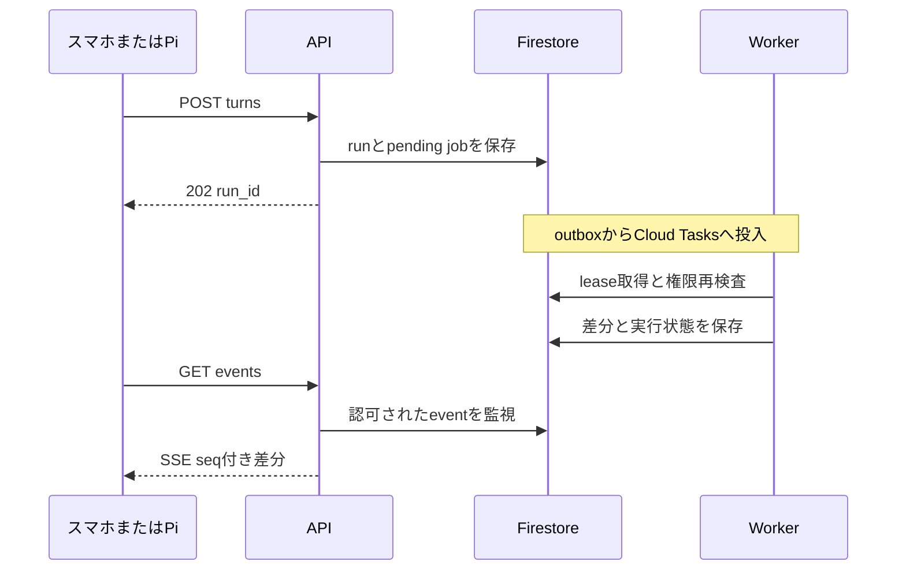
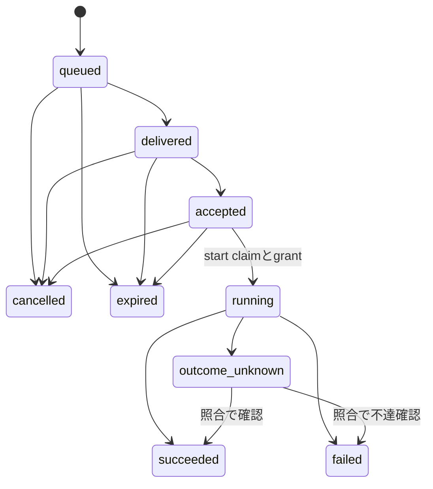

# インターフェース仕様

| 項目 | 値 |
| --- | --- |
| 状態 | 開発着手用の設計ベースライン案。APIの起動・health・共通エラーを提供。業務API・端末サービスは未実装 |
| 文書版 | 0.2.0 |
| 更新日 | 2026-10-26（日本時間） |
| 責任者ロール | API担当。スマホ・Pi・AgentCore担当が共同レビュー |
| 関連 | [基本設計](02-architecture.md)、[データ・権限](03-data-and-authorization.md)、[開発・テスト](05-development-and-testing.md) |

## 1. 契約の正本と対象範囲

| ファイル | 定義する対象 |
| --- | --- |
| [openapi.yaml](../specs/openapi.yaml) | HTTP APIのパス、入力、出力、認証方式、ステータス |
| [device-protocol.schema.json](../specs/device-protocol.schema.json) | Pi WebSocketのJSONフレーム |
| [run-events.schema.json](../specs/run-events.schema.json) | 会話SSEの `data` 部分 |
| [tool-contracts.schema.json](../specs/tool-contracts.schema.json) | LLMが提案できるtool名と引数 |

HTTPはOpenAPI 3.1、各JSON SchemaはDraft 2020-12を採用する設計案である。型・必須項目はスキーマを正本とし、本書は認可、状態遷移、再試行、異常時の意味を定義する。JSON SchemaだけではDB上の権限、存在、時間順序、同一tenant、providerの能力を証明できないため、これらはサービス層で必ず検査する。

この版は利用者・端末向けの契約である。Cloud Tasksからworkerを呼ぶ内部HTTPは公開APIと分離し、Cloud Run IAMで呼出し主体を限定する。BA-FND-04でこの契約からHTTPクライアントを生成し、ローカルの検証・再生成差分・互換性比較を提供する。[利用手順](contracts.md#httpクライアントと契約検証)を参照する。CIへの組込みは後続チケットで行う。

## 2. 共通規約

### 2.1 HTTP、認証、スコープ

- base pathは `/v1`、HTTPS必須、JSONのキーはsnake_case。成功・失敗ともUTF-8を使う。
- スマホは `Authorization: Bearer <Firebase ID token>`、Piサービスは端末専用の短命bearerを送る。Piは所有者のFirebase credentialを持たない。
- Piの個人操作には `X-Private-Session` を追加する。このIDは端末bearerに付随する参照であり、単独の資格情報ではない。
- サーバーはURLのtenant選択をmembershipまたはdeviceの所属と照合し、resourceを同じtenant内で解決する。
- 権限変更・削除・個人セッション終了は既存のSSE/WSS・workerにも適用する。接続時だけのチェックにしない。
- 破壊的なアカウント/tenant削除は、直近5分以内のFirebase再認証を初期条件とする。単に有効期限内の古いtokenを持つだけでは満たさない。
- contentを返す応答は `Cache-Control: no-store` とし、CORSは登録済みクライアントのoriginに限定する。APIの `CLIENT_ORIGINS` と公開headerは [UI認証の設定](ui-authentication.md#設定と実接続)に従う。

データのvisibilityとdisplay_policyの条件、role、本人確認は[データ・権限設計](03-data-and-authorization.md)を適用する。unknown speakerのPiが記憶・ノート・タスクを書き込むことは認めず、対応scopeを持つ本人セッションを要求する。

Entityの4操作とquery/cursorの実装、Piのkind別制限、外部ID登録の内部専用境界は[Entity API](entities-api.md)に定める。公開EntityCreateはexternal_refsを受け付けず、正規provider inventoryからの内部登録のみが外部IDを照合する。

### 2.2 版、ページング、冪等性

| 項目 | 契約 |
| --- | --- |
| リソースID | UUID。Firebase UID、providerのcalendar/event IDはopaque string |
| 時刻 | UTC RFC 3339。利用者の解釈には別のIANA timezoneを保持 |
| 更新版 | 応答の `version` と `ETag: "3"` を対応させる |
| PATCH/DELETE | `If-Match: "3"` 必須。欠落428、版不一致412。POSTによる実行指示は固有状態検査を行う |
| ページング | `limit` 既定20、最大100。opaque cursorはtenant/actor/query/認可版に束縛 |
| 冪等キー | 更新系は `Idempotency-Key` 必須、16〜128文字。tenant/actor/operation/keyごとに24時間保持 |
| 同じキーの再送 | 同じ正規化bodyなら同じresource/operation/result。異なるbodyは409 |
| read型POST | `memories:search` は共通headerを受けるが副作用台帳は不要 |
| 追跡 | 全HTTP応答の `X-Request-ID` にサーバー発行UUIDを返す。エラー本文の `request_id` と一致し、呼出元の同名headerは採用しない。本文・tokenはログから除外 |

BA-FND-03のPython共通型とOpenAPI/JSON Schemaの対応、日時の保存プロファイル、IANA名検証、内部Contextの境界は[共通型の対応表](contracts.md)を参照する。offset付き入力はUTCへ正規化し、小数秒は最大6桁、未知offsetの `-00:00`・うるう秒は拒否する。

BA-FND-08の提供済みAPI内部helper、現在認可callback、Firestore transaction、再送用receiptの制約とcursor鍵の扱いは[共通処理の利用契約](common-mutations.md)を参照する。業務routeへの接続は各機能チケットで行う。

BA-RUN-03 の agent 一覧・取得は user/device が同じ設定版を共有し、更新は owner/admin の user bearer に限定する。人格文は実行権限を付与しない。[人格設定と文字 Core](text-agent-core.md)に現在認可・ETag・冪等再送と内部履歴の境界を定義する。

BA-IAM-01の `GET /v1/users/me`、Firebase本人認証、直近再認証、未認可のtenant選択値の境界は[本人認証の利用契約](authentication.md)を参照する。membership認可はBA-IAM-02で追加する。

BA-IAM-07 の[端末ペアリング・資格情報](device-pairing.md)は、上記24時間の汎用冪等処理に秘密応答を保存しない。開始応答は5分、exchange/refreshの同一要求再送は60秒未満に限り専用暗号化 receipt から返す。各refreshでは新しい request UUID と Idempotency-Key を作り、応答喪失時は同じ本文・両識別子を再送する。別の更新要求や猶予後の使用済みrefresh提示はfamilyを停止する。

期限切れの冪等キーを使った新しい操作を、古い操作と同一だと仮定しない。端末コマンドのdedupは別途7日保持し、実行期限は30秒とする初期案である。provider側で結果が不明な場合は再送より先に状態を照合する。

### 2.3 共通エラー

```json
{
  "error": {
    "code": "version_conflict",
    "message": "内容が更新されています。再取得してください。",
    "request_id": "e70e4141-e7c3-45c5-92f9-f3cebf387dde",
    "retryable": false
  }
}
```

| HTTP | 主なcode／意味 | クライアントの挙動 |
| --- | --- | --- |
| 400 / 422 | `invalid_request` / `validation_failed` | 入力・曖昧な日時・未対応機能を修正 |
| 401 | `authentication_required` / `token_expired` | 1回更新し、失敗したら再認証 |
| 403 | `operation_forbidden` / `reauth_required` | 機能権限の不足。自動再送しない |
| 404 | `resource_not_found` | 他tenant/他人privateの存在も隠す |
| 405 | `method_not_allowed` | パスで許可されたHTTP methodを使う |
| 409 | `idempotency_conflict` / `already_executing` / `pairing_pending` | 状態・入力を確認。pairingのみ期限内の間隔付きpoll |
| 410 | `resource_expired` / `event_history_expired` | 状態を再取得。古い操作を新規実行へ変換しない |
| 412 / 428 | `version_conflict` / `version_required` | 再取得・差分確認後に更新 |
| 413 | `payload_too_large` | 音声/本文を短くする |
| 429 | `quota_exceeded` / `rate_limited` | Retry-Afterに従う。上限を利用者に表示 |
| 503 | `temporarily_unavailable` / `control_ledger_unavailable` | 同じ冪等キーでbackoff。受付未完了を明示 |
| 500 | `internal_error` | 未分類の失敗。retryable=falseとして自動再送を避ける |

エラーの詳細に別ユーザーのID、provider token、内部promptを含めない。クライアントはerror.codeで分岐し、自然文のmessage文字列に依存しない。

BA-FND-02では要求検証・HTTP例外・未処理例外をこの形式へ統一する。messageは固定の公開文言で、validationの入力値や例外detailを返さない。未処理例外はHTTP 500、readinessの依存異常は503を返す。既にstreamのheaderを送信した後の失敗は共通JSONへ差し替えず接続を中断し、同じrequest IDで `internal_error` を記録する。

### 2.4 ヘルス確認

| パス | 成功 | 失敗と意味 |
| --- | --- | --- |
| `GET /health/live` | 200 `{"status":"ok"}` | HTTP要求に応答できるかを確認。依存先を呼ばない |
| `GET /health/ready` | 200 `{"status":"ready"}` | 起動未完了、登録probeのfalse・例外・timeoutは共通エラー503。code=`temporarily_unavailable`、retryable=true |

healthは `/v1` の外に置き、認証情報を要求しない。依存先の名前・接続先・失敗詳細は返さず、全応答を `Cache-Control: no-store` とする。現時点の標準構成はhealthのみで外部依存probeを持たないため、readyは起動完了だけを意味する。Firestore等のadapterを実装するチケットで、そのlifespanとprobeを登録する。

[テナントAPI](tenants.md) は user 単位の作成冪等性、現在 membership による選択、管理者の設定更新、現在権限へ束縛した所属一覧 cursor を提供する。作成/更新の再送は現在の Tenant と対応する ETag を返す。

[会員管理API](memberships.md) は current ledger による会員一覧と、tenant 内で直列化した role 更新・所属失効・owner 移譲を提供する。role 更新・失効は `PATCH/DELETE /tenants/{t}/memberships?user_id={uid}` で任意の opaque UID を指定する。既存 UID path 経路も互換維持するが、dot segment 正規化を受ける UID には query 経路を使う。transfer の `If-Match` は本人の認可版、本文の `target_version` は移譲先の認可版。新 owner を確定してから旧 owner を member へ変更し、途中失敗は同一要求で再開する。

## 3. HTTP機能グループ

下表のパスには `/v1` を前置する。`{t}` 等は説明用の省略で、完全な名称・全operationはOpenAPIを参照する。

| 機能 | 主なパス | 認可・結果 |
| --- | --- | --- |
| 認証後の本人情報 | `GET /users/me` | 現在のプロフィール。認証自体はFirebase SDK |
| テナント | `GET/POST /tenants`、`GET/PATCH /tenants/{t}` | 所属一覧/作成/設定 |
| 会員・招待 | `/tenants/{t}/memberships`、`/invitations`、`POST /invitations:accept` | role変更、失効、コード招待。`POST /tenants/{t}/memberships:transfer-owner` は本人ownerから移譲 |
| 共有人格 | `/tenants/{t}/agents`、`/agents/{a}` | 読取りと管理者による人格更新 |
| 端末登録 | `/device-pairings`、`/tenants/{t}/device-pairings:confirm`、`/device-pairings/{p}:exchange` | 未登録Pi開始→スマホ確認→Pi資格情報受領 |
| 端末管理 | `/tenants/{t}/devices`、`/devices/{d}`、`POST /device-tokens:refresh` | 許可範囲、失効、token更新 |
| 個人セッション | `POST /tenants/{t}/devices/{d}/private-sessions`、`GET/DELETE /tenants/{t}/private-sessions/{s}` | [本人スマホで開始・現在状態・終了](private-sessions.md) |
| 端末再同期 | `GET /devices/{d}/snapshot` | active session・出力割当run・未完了command/notification・cursor |
| 会話 | `/tenants/{t}/conversations`、`/conversations/{c}/messages`、`/conversations/{c}/turns` | 許可された会話の閲覧・発話受付 |
| 実行 | `/tenants/{t}/runs/{r}`、`/events`、`POST /runs/{r}:cancel` | 状態、SSE、生成停止 |
| 音声 | `POST /tenants/{t}/audio-inputs`、`GET /tenants/{t}/speech-outputs/{s}/audio` | STT inputと認可付きTTS |
| 記憶・エンティティ | `/tenants/{t}/entities`、`/memories`、`POST /memories:search` | 型付き登録、検索、訂正。忘却はoperation |
| ノート・タスク | `/tenants/{t}/notes`、`/tasks` | 作成・一覧・取得・更新。削除はoperation。[ノートAPI/tool](notes.md)・[タスクAPI/tool](tasks.md)を提供 |
| リマインダー | `/tenants/{t}/reminders`、`POST /reminders/{r}:snooze` | due_at、対象、取消し、新schedule_versionによる再設定 |
| スマホ通知 | `/users/me/push-installations`、`/tenants/{t}/notifications`、`/tenants/{t}/notifications/{n}`、`/tenants/{t}/notifications/{n}:ack` | FCM token登録と本人通知。本文をpushに入れない |
| 外部連携 | `/tenants/{t}/integrations`、`/google-calendar/authorizations`、`/home-assistant` | 本人OAuth/端末HAのmetadata。秘密を返さない |
| Calendar | `/integrations/{i}/calendar-events`、`/calendar-proposals`、`/calendar-proposals/{p}:confirm`、`:reject` | 参照→内容提案→本人確認/否認→checkpoint再開 |
| Calendar解除 | `GET/DELETE /integrations/{i}` | 本人の停止理由・再接続可否・消去状態。DELETEの202は受付、消去完了はcleanup_statusで確認。[解除契約](calendar-disconnect.md) |
| 家電操作 | `POST /tenants/{t}/commands`、`GET /commands/{c}`、`POST /commands/{c}:cancel` | 保存・配送・実行観測を分離 |
| 削除・export | `/tenants/{t}/operations`、`/operations/{o}`、`/operations/{o}/download` | 非同期の進捗/認可付き取得 |
| アカウント削除 | `POST /operations`、`GET /operations/{o}` | 本人再認証。他tenant管理者から呼べない |
| 利用量 | `GET /tenants/{t}/usage` | memberは本人分、owner/adminはtenant総量。[予約・精算とUTC月次集計](usage.md) |

BA-IAM-04 で `POST /tenants/{tenant_id}/invitations` と `POST /invitations:accept` を実装済み。コードは24時間・一回利用、照合は UID ごと15分5回まで。失効後は新規発行コードと確定grantを要求する。[再送・台帳・エラーの契約](invitations.md)に従う。招待の送信機能はMVPの必須契約に含めず、生成コードを利用者が共有する。Home AssistantのURL・tokenはPiのローカル設定に置き、クラウドへ任意のLAN URLを渡して接続させない。

## 4. 会話と音声の流れ

BA-RUN-04の[会話・永続文字run](conversations-and-runs.md)は会話CRUD、message一覧、text turnの202受付とrun GETを実装する。同一会話の進行中turnは409で直列化し、独立workerが最終結果を保存する。BA-RUN-05はSSE差分・履歴再開を実装する。BA-RUN-07はrun取消と確認checkpoint・内部結果受取・再開を実装する。BA-CAL-03はCalendar proposal生成/取得/rejectを接続する。本人confirm HTTPと外部書込、音声停止は後続実装。

### 4.1 永続実行とSSE



APIのHTTP応答後にプロセス内の背景taskを走らせ続ける設計にしない。Cloud Tasks workerがrunを処理し、lease generationで重複workerを排除する。外部副作用前後に状態を保存し、再開時は完了済みtoolを繰り返さない。

確認を待つ場合、workerはrun/tool_call/checkpointとproposalを結び付けて永続化し、`waiting_confirmation` とした後leaseを解放する。confirmは同じproposalの一回状態遷移とpending resume jobをtransactionで保存する。実行結果をcheckpointへ確定した後にAgentCoreを再開し、同じtoolを新規実行しない。reject・期限切れは否認/失効結果のresume jobを作り、利用者へ実行しなかったことを伝えてrunを終了する。run cancelは未確定proposalをcancelledにし、再開を抑止する。UIから単独作成したproposalにはrun/checkpointを付けず、operationだけを処理する。

LLMのtokenごとにFirestoreへ書くことは避け、初期案では250msまたは1KiB程度の差分で集約する。`seq` はrun内で単調増加とし、状態イベントは順序を保って永続化する。SSEの `id` はseq、`event` はtype、`data` はJSON Schemaに一致させる。接続は認証header付きfetchで読み、再接続時に `Last-Event-ID` を送る。クライアントは既読seqを再適用しない。

run eventsの保持は初期24時間とし、期限後は410を返してrunと最終messageを再取得する。私的な会話の削除・session失効では期限内でも配信を止める。定期heartbeatは通信維持用で本文ではなく、`seq`を消費しないSSEコメントとする。

| run状態 | 意味 |
| --- | --- |
| `queued` | 入力と実行要求を永続化した |
| `running` | workerがleaseを持ち処理している |
| `waiting_confirmation` | Calendar等の確認待ち。workerはleaseを解放可能 |
| `completed` | 回答の生成完了。外部操作結果は各tool/commandの状態を参照 |
| `failed` | 実行失敗。副作用がある場合は個別状態を示す |
| `cancelled` | 生成・未実行処理を停止。実行済み副作用の取消しを意味しない |

### 4.2 タップ音声の初期契約

MVPは1発話ごとのuploadを使う。入力は16kHz・16bit・mono PCM WAV、上限60秒かつ5MiBとする。スマホ/Piのaudio adapterで変換する。APIはメモリ内で受けてSTTを行い、音声バイトを自システムのDB・ファイル・ログへ保存しない。返る `audio_input_id` はtenant/actor/sessionに束縛されたtranscript参照で、初期15分で失効する。providerの保持方針は別途運用文書で確認する。BA-VOICE-01 の実装・利用量・期限・再送・設定は[音声入力契約](audio-inputs.md)を参照。STT設定未指定は503で、暗黙のfakeや実providerへ切り替えない。

`POST turns` は `text` と `audio_input_id` の一方だけを受け取る。TTSを希望する場合は `output_mode=speech` とし、出力Piを指定する場合は `output_device_id` も権限検査する。Piは許可されたrunのSSEを購読し、sentence単位の `speech.ready` にあるIDで音声を取得する。

TTSは最初の確定文から順次生成する。`GET speech-outputs/{id}/audio` は現在のrun/session/表示方針を再検査し、その文を合成したaudio/wavを返す。合成バイトを永続化せず、参照は初期5分で失効する。切断中の古い読み上げを自動で再生しない。再取得は追加合成費用が発生し得るため、参照ごと最大2回・同時1回をtransactionで制限する。実装・認可・利用量・設定・公開前条件は[音声出力契約](speech-outputs.md)を参照。

[音声UIの結合](voice-ui.md)は明示録音、初回live streamとPiの短命待機/未来文attachを接続する。snapshot:validate成功応答の `X-Brainoid-Observed-At` を新規待機のserver時刻境界に用いる。

読み上げ停止はクライアントの音声キューを即時消去する。生成停止はrun cancelを呼ぶ。家電や予定の未実行操作の取消しは専用状態に従う。UIでこれらを同じ成功メッセージにまとめない。

## 5. Pi WebSocketと端末コマンド

詳細な現在の実装契約は[端末の状態復旧](device-snapshot.md)を参照する。

### 5.1 接続とフレーム

Piサービスが `WSS /v1/devices/{device_id}/connect` に接続し、subprotocolは `brainoid-agent.device.v1` を提案する。bearerはAuthorization headerへ入れ、queryには置かない。UIのブラウザが直接cloud device credentialを持つ構成にはしない。

| フレームtype | 方向 | 役割 |
| --- | --- | --- |
| `hello` / `hello_ack` | Pi→API / API→Pi | protocol・能力・generation・leaseの確定 |
| `heartbeat` / `heartbeat_ack` | 双方向 | 初期15秒間隔。失効確認・時刻差・lease更新 |
| `command` | API→Pi | 永続コマンドの配送 |
| `command_status` / `command_status_ack` | Pi→API / API→Pi | 受領・結果と観測情報の記録 |
| `command_start` / `command_start_result` | Pi→API / API→Pi | 実行直前の原子的なclaimとgrant |
| `notification` / `notification_ack` | API→Pi / Pi→API | 表示許可済み通知・表示結果 |
| `session_started` | API→Pi | 個人session開始・scope・期限 |
| `run_available` | API→Pi | Piへ割り当てられたrunとSSE再開位置 |
| `session_revoked` | API→Pi | 個人内容・再生・cacheの消去要求 |
| `error` | 双方向 | 秘密を含まないprotocolエラー |

APIインスタンスは接続端末に限定したFirestore server-side watchでcommandsを監視する。別インスタンスが作成したコマンドもDB経由で配送し、インメモリの接続表だけを配送経路にしない。Firestore資格情報をPiへ配布しない。

hello_ackを受けたPiは必ずHTTP snapshotを取得し、next_cursorがなくなるまで続頁を読む。snapshotは現在のactive session、出力割当run、未完了command/notification、delivery cursorを返す。個人session開始・run割当はDBに保存してから対応frameを配信し、frame喪失時もsnapshotから復元できるようにする。Piは割当runのSSEへ接続し、output assignment generationと現在sessionを照合して表示/再生する。再接続で見つかった古いspeechを自動再生しない。snapshotにない失効sessionのローカル本文は消去する。

WSSの `connection_generation` は `device_connections` のtransport世代であり、既存device/credential/command/sessionの同名フィールドが表す認可世代とは区別する。再接続は認可世代を変えない。両方の検査と配送hookの責務は[WSS gateway](device-gateway.md)を参照する。

接続には単調増加する `connection_generation` と期限付きleaseを持たせ、新しい接続を確定したら旧generationを無効にする。Piもgenerationを検査し、古い接続からの新規実行を拒否する。heartbeatが3回分途絶えたらofflineとして扱い、再接続はjitter付き指数backoff（初期1秒、最大30秒）とする。

Cloud RunのWebSocketはrequest timeoutの対象で、最大60分・既定5分である。初期設定は60分とし、55分前後のjitter付き再接続と、予期しない切断からの再同期を実装する。session affinityに正しさを依存させない。[公式資料](https://docs.cloud.google.com/run/docs/triggering/websockets)

### 5.2 コマンド状態



`delivered` は送信した、`accepted` はPiが受領した状態であり、成功ではない。Piは実行前にcommand IDをSQLiteに記録し、同じIDの再配送には保存済み状態を返す。commandに含まれるtenant/device/target、generation、期限、本人session、operation型と範囲を検査する。serverとPiの両方で `expires_at` を確認し、端末時計が信用できない場合は実行を拒否して時刻同期を要求する。

BA-DEV-02の[端末台帳](device-storage.md)は受領/cursorの同時commit、execution IDと開始/結果の保存、既定7日の安全な掃除、保存障害時の復旧状態とlocal resetを提供する。wireのschemaや実行認可を代行せず、配送・grant・HAの接続はDEV-05/06/07で行う。

成功条件は対象のHA操作が受理され、期待する状態を観測できることとする。照明のon/off、輝度設定、空調の目標温度・モード設定に限定し、`toggle` は使わない。`outcome_unknown` はネット切断などで結果を確定できない状態で、成功とも失敗とも表示しない。HAの現在状態・execution IDを照合してから再試行を判断する。

実行直前にPiは `command_start` をexecution IDと現在generation付きで送る。APIは状態・期限・認可・sessionをFirestore transactionで検査し、実行可能なcommandをrunningへ原子的にclaimしてgrantを返す。Piは同じgeneration・execution IDの有効なgrantを確認して初めてHAを呼ぶ。grant応答喪失時は同じexecution IDで照合し、推測して実行しない。SQLiteの開始/完了記録により、同じgrantの再受信で再実行しない。

取消しとstart claimは同じ状態を原子的に更新する。queued/delivered/acceptedでもまだclaimされていなければcancelledへ移せる。claim済みのrunning以降は409を返し、必要なら別操作で新しい目標状態を設定する。旧接続の処理やgrantの遅延もgeneration・command ID・観測で照合する。serverがACKを送ったことだけを家電成功としない。

BA-APP-06の[command受付契約](commands.md)はHTTP create/get/cancelと既定home.set_stateを提供する。cancelのIf-Matchは任意で、指定時は期待版を検査する。BA-DEV-05の[実claim/grant・配送・結果ACK契約](device-gateway.md#durable-command-boundary-ba-dev-05)は同じcanonical文書を使う。HA実行・ACK喪失・再起動照合は[DEV-07](device-commands.md)が接続する。BA-DEV-06の[HA adapter・canonical inventory](home-assistant.md)がdevice-authenticated同期を提供する。未構成の信頼済みinventoryからcommandを作成しない。

Cloud Tasksの重複実行は起こり得るため、worker・通知・provider操作はジョブIDと処理状態で冪等にする。キューが順序やexactly-onceを保証すると仮定しない。[公式資料](https://docs.cloud.google.com/tasks/docs/common-pitfalls)

## 6. Calendar、記憶、通知の特有ルール

### 6.1 Calendarの確認と競合

BA-CAL-01は[Calendar OAuth](calendar-oauth.md)の開始・匿名callback・本人metadata一覧を提供する。未構成runtimeは503で閉じる。OAuth開始は本人スマホから行い、scope_profileをread/read_writeで分ける。callbackのstateをuser/tenant/nonce/期限に束縛し、成功後は登録済みの復帰先へ戻す。URLのcode/token/stateはアクセスログでredactする。

BA-CAL-02は[Calendar予定参照](calendar-events.md)の本人allowlist更新と予定一覧、および既定calendar.listを提供する。取得時刻、UTCとIANA timezone、終日の排他的終了日を保持する。

BA-CAL-03は[Calendar操作proposal](calendar-proposals.md)の生成・取得・否認・期限回収と既定calendar.proposeを提供する。会話では同期限のcheckpointとconfirmation.requiredを保存し、worker leaseを解放する。

BA-UI-08の[Calendar画面](ui-calendar.md)は、ネイティブOAuth復帰後の現在認証による再取得、本人のcalendar選択、予定一覧、固定proposalの確認・拒否、operationと解除の消去状態を提供する。Pi画面から書込確認を代行しない。

`calendar-proposals` は作成/変更/削除の正規化内容、対象、本人、args_hash、初期5分の期限を保存する。実行confirmは本人スマホからのみ受け、同じproposalとhashに対して一度だけ進める。日時はtimezoneを含めて表示し、endがstartより後であることを検査する。終日予定はdateで表現し、終了日は排他的終端とする。

作成時はoperation IDからprovider仕様に適合するevent IDを作り、結果不明ならそのIDで照合する。更新/削除はprovider ETagをIf-Matchに渡し、競合時は再確認する。Google Calendarは条件付き更新/削除でETagを利用できる。[版管理の公式資料](https://developers.google.com/workspace/calendar/api/guides/version-resources)、[event IDの公式資料](https://developers.google.com/workspace/calendar/api/v3/reference/events/insert)

MVPでは単発予定の本人calendarへの操作を対象とし、参加者への招待、会議送信、繰り返し系列の一括編集は受け付けない。providerが操作を完了したか不明な場合はoperationを `outcome_unknown` に保つ。

### 6.2 記憶の保存・訂正・忘却

記憶保存時は出典・scope・subject/objectの存在を検査し、user_explicit/confirmedはサーバーで設定する。JSON入力に `status=confirmed` を指定できる汎用エンドポイントは設けない。直接フォーム入力で既存出典がない場合はsource_refsを空配列とし、本人と記録時刻を出典としてUIに示す。存在しないmessage IDを生成して根拠にしない。[明示記憶API](memories-api.md)では出典表示用のcreated_byとrecorded_atを返し、source_refs省略時を空配列、valid_from省略時をサーバー時刻とする。

PATCH memoryはIf-Match付きのrevisionで、旧factをsupersededにし、新factを返す。forgetはoperationで受け、`source_policy` の既定は `suppress_reuse` とする。元出典をUI履歴に残す場合でも、該当span（特定できなければmessage全体）をモデルcontext・要約・検索・再抽出から除外する。`delete_source` は削除権限を持つ出典も削除する選択である。

削除/forgetの202は独立した削除台帳への先行記録とDB tombstoneの保存後に返す。台帳失敗は503、台帳成功後DB失敗は同じoperationを再構築する。202は受付であり、全物理削除の完了ではない。exportは取得のたびに現在の権限・deletion epoch・期限を再評価し、忘却や退出で生成済みファイルも失効する。

membership/deviceの減権限・失効・owner移譲もDB外認可変更台帳を使う。denyは先行適用し、grantはDB適用確認済みの記録のみを使う。未確定主体をsuspendedにして安全にroll-forwardし、古いbackupの権限を復活させない。

### 6.3 リマインダーと通知

BA-APP-03 の管理 API・tool・予定世代判定は[リマインダー実装契約](reminders.md)、BA-APP-04 のlocal期限走査・通知job・receiptは[通知実装契約](notifications.md)を参照。BA-APP-05の本人installation・通知一覧/単体取得/ack・FCM汎用payloadと失敗回復も同契約に記載する。

公開Notificationは初回version=1から本文・receipt更新で版を進め、単体GET/ackは同じ公開版のETagを返す。更新時刻は現在Reminderとreceiptの新しい方で、同時刻の変更も版で区別する。内部sourceと保存済み配送grantの固定版とは別である。同key再送・同じackの再確認は現在内容を返し、追加の更新を行わない。

DBのdue_atを正本とし、Schedulerの定期走査とCloud Tasksで配信する。通知IDはreminder IDと予定版から決定し、同じ通知を重複作成しない。予定を変更・取消した場合は古い版のジョブを無効化する。

再通知は `POST reminders/{id}:snooze` に未来のdue_at/timezone/expected_versionを指定する。サーバーはversionを照合し、schedule_versionを増加してstatusをscheduledへ戻し、旧通知と旧jobを無効化する。通常のPATCHでdue_atを変更した場合も同じ予定版更新を行う。既に届いたpushは取り消せない場合があるため、開いたクライアントは最新schedule_versionを確認し、古い本文・読み上げを表示しない。

スマホpushには通知ID・tenant ID・汎用文言だけを載せ、ロック画面に個人の予定や記憶を送らない。起動後の認証付きAPIで本文を取得する。Pi通知はdisplay_policy/sessionを配送時と表示時に確認する。共有Piへの個人通知は、本人sessionが有効で許可した場合だけ表示する。

初期案では期限から5分を過ぎた通知を自動読み上げせず、未確認一覧で示す。OSへのpush受理、Piでのdisplayed、本人のacknowledgedを別状態として保存する。push到着時刻をサービスの厳密な保証としない。

BA-MEM-09の[本人エクスポート](data-export.md)は明示local構成で提供する。downloadは認証付き `application/zip`（内部 `data.json`）、受付から24時間、最大200対象・4MiB。毎回とstream送信境界で現在の権限・全manifestを検査し、公開URLを返さない。

## 7. Toolとローカル境界

LLMに公開するのは型付きのtool名とargumentsであり、TenantContext/ActorContext、OAuth token、端末credential、実行済み確認情報は公開しない。ToolExecutorは実行ごとに現在の権限・対象・quota・確認を検査する。modelが返したJSONをそのままproviderへ中継しない。

`memory.remember` や `notes.create` は明示的な利用者の依頼があるときに使う。`memory.forget`・削除toolも現在の文脈に明確な削除対象があることを検査し、曖昧なら確認する。`calendar.propose` は提案までであり、`calendar.confirm` はモデルtoolとして公開しない。すべてのtool結果は `tool_call_id` と永続operation/commandへ関連付ける。

PiローカルUIとdevice serviceはloopbackで接続し、Host/Origin/sessionを検査する。状態変更にはCSRF対策を行い、cloud credentialsをブラウザへ渡さない。ローカルUI契約はcloud API型を再利用し、mic/再生/停止/ネット状態のadapterだけを追加する。LAN全体に開放する管理APIはMVPに含めない。

BA-DEV-01で実装したローカルHTTPのpath、header、session期限、失敗応答、static/credential境界は[Piサービス契約](device-service.md#http-契約)を正本とする。公開cloud OpenAPIには追加しない。

## 8. 互換性と契約検証

破壊的なフィールド変更・削除・意味変更はHTTP major versionまたはdevice protocol majorを上げる。既存enumへ新しい値を追加する場合も、旧clientの分岐に影響するため互換性レビューを行う。deviceはhelloで能力とprotocolを広告し、serverは対応しないコマンドを送らない。

受信フレームはsize上限64KiB、JSON検証、未知type拒否、頻度制限を行う初期案とする。更新時はserverが新旧deviceを受け入れる期間を設け、rollback先でも保存データを読めるexpand/contract migrationを使う。

契約の検証項目は、構文・参照解決、正例/負例、tenant差替え、期限切れ/重複/旧generation、再接続seq、本人session終了後の遅延TTS、削除後のjob結果、Calendar二重確認・競合である。この文書パッケージの静的検証と、今後実装するAPI/実機の試験結果は区別して記録する。

BA-IAM-08の端末一覧・設定・失効、scope変更時の資格情報停止、明示再登録は[端末管理契約](devices.md)を参照する。全管理APIはowner/admin専用で、PATCH/DELETEはIdempotency-KeyとIf-Matchを必要とする。
